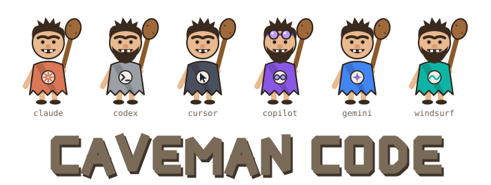

<div align="center">

<picture>
  <source media="(prefers-color-scheme: dark)" srcset="docs/readme/logo-dark.svg"/>
  
</picture>

**An agent skill that makes AI write code a caveman could read**

<a href="https://www.npmjs.com/package/@xuckless/caveman-code"></a> <a href="#license"></a>

[Install](#install) · [Rules](skills/caveman-code/SKILL.md) · [Failure catalog](skills/caveman-code/examples/llm-failures.md) · [Evals](evals/)

</div>

## Install

```sh
npx @xuckless/caveman-code --project
```

This installs the skill into `.claude/skills` in the current repo. Add `--agent codex,cursor,copilot,windsurf,antigravity` (or `all`) for other agents, or drop `--project` to install it for your user. All of them read the same `SKILL.md`.

## One state, not four booleans

Every lifecycle is one value with named transitions, so impossible states can't exist.



## Rules are rows, not branches

Behavior lives in tables a small engine reads. A new feature is a new row.



## Simple, never short of the spec

The least code that meets every requirement: no flags, layers or options nobody asked for, and nothing the spec asked for left out. Tests are small code with many rows.

## Measured, not vibes

Thirty tasks in six languages, each built with and without the skill and judged blind. Fresh agents without the skill then had to maintain the result.



[Method and raw results](evals/results/)

## Review a diff

`/caveman-review` checks a diff against the rules and lists each finding with its fix.

It is not a correctness review. For concurrency or lifetime refactors, pair it with an adversarial one. In [Anole](https://github.com/xuckless/anole)'s S3 audit, making state explicit surfaced 9 latent bugs, including use-after-free and leak paths that earlier reviews had missed, and the correctness review caught 9 refactor bugs the caveman review missed.

## License

MIT
